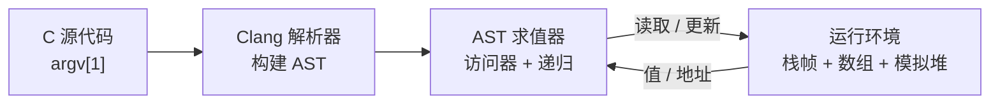
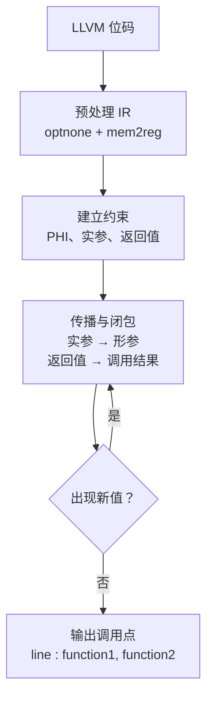
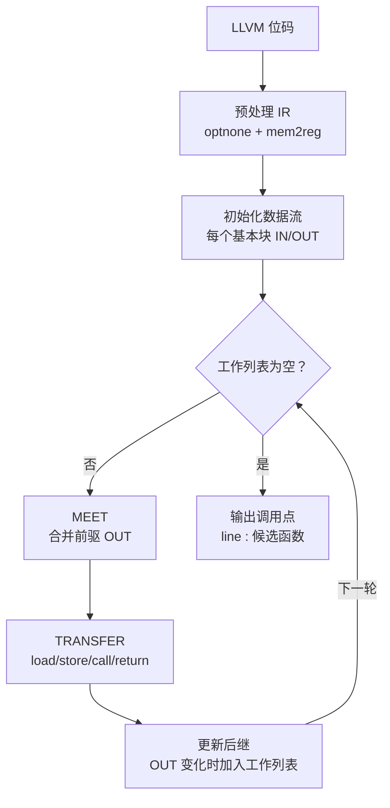

# 编译原理实验

本仓库包含三个基于 Clang/LLVM 的编译原理课程实验。每个实验相互独立，并各自包含`CMakeLists.txt`。

## 环境要求

- CMake
- LLVM 与 Clang 开发库（代码使用旧版 PassManager API）
- Clang（用于将实验二和实验三的 C 测试用例编译为 LLVM 位码）

## 实验一：AST 解释器

**任务：** 直接基于 Clang AST 执行受限的 C 程序。

解释器支持整型、字符和指针值、数组、算术与比较表达式、赋值、`if`、`while`、`for`、函数调用与返回，以及内置函数 `MALLOC`、`FREE`、`GET` 和 `PRINT`。

**实现：** 使用 `clang::tooling::runToolOnCode` 解析源代码文本。`ASTConsumer`查找 `main` 函数和内置函数声明，`EvaluatedExprVisitor` 遍历表达式与语句。解释器维护显式栈帧，每个栈帧将声明和 AST 表达式映射到对应的值、数组和地址；独立的模拟堆负责管理动态分配的内存。语句采用递归方式求值，函数调用会创建新栈帧，指针算术按所指类型的大小进行缩放。

**算法思路：**



*求值器递归遍历 AST，并读取或更新运行环境。*

## 实验二：函数指针分析

**任务：** 对于由 C 代码生成的 LLVM 位码文件，找出每个调用点可能调用的函数，并按以下格式输出：

```text
line : function1, function2
```

**实现：** 该 Pass 首先移除 `optnone` 属性，并运行 `mem2reg` 将局部变量提升为 SSA 形式。随后根据 PHI 节点以及函数调用/返回的数据流，建立 `值 -> 可能值集合` 的约束关系。实参信息会传播到形参，返回值会传播回调用结果；这些别名/值关系会被反复迭代扩展，直到到达不动点。最后，每个调用点被解析为直接调用目标或候选函数集合，并按其源代码行号输出。

**算法思路：**



*可能值在调用关系中不断传播，直到不再出现新的候选函数。*

该分析是流不敏感且上下文不敏感的。测试用例及期望输出位于`assign2/assign2-tests`。

## 实验三：基于数据流的指向分析

**任务：** 实现流敏感、字段不敏感且上下文不敏感的指向分析，并按照相同的 `line : function1, function2` 格式输出每个调用指令可能调用的函数。

**实现：** `Dataflow.h` 提供通用的基于工作列表的数据流框架，计算每个基本块的 `IN` 和 `OUT` 值，并同时支持前向和后向分析。`FuncPtr.h` 定义分析状态：从 LLVM 值到可能目标值集合的指向映射、已解析调用点的映射，以及可能的返回值集合。传递函数处理内存加载与存储、地址计算、函数调用、返回和指针类型转换；在汇合点按集合并集合并指向集合。对于间接调用，使用实参的指向信息绑定被调用函数的形参，并递归分析被调用函数；随后将其返回值和副作用合并回调用者。由此得到一个不带上下文敏感性的过程间不动点分析。

**算法思路：**



*基本块反复进入数据流工作列表，直到指向集合不再变化；函数调用会被递归分析。*

`Liveness.h` 作为后向数据流分析示例包含在项目中。测试用例及期望输出位于`assign3/assign3-test`。

## 构建

```bash
# 实验二和实验三
cmake -S assign2 -B build/assign2 -DLLVM_DIR="$(llvm-config --cmakedir)"
cmake --build build/assign2

cmake -S assign3 -B build/assign3 -DLLVM_DIR="$(llvm-config --cmakedir)"
cmake --build build/assign3

# 实验一还需要 ClangConfig.cmake
cmake -S assign1 -B build/assign1 \
  -DLLVM_DIR="$(llvm-config --cmakedir)" \
  -DClang_DIR="$(dirname "$(llvm-config --cmakedir)")/clang"
cmake --build build/assign1
```

## 运行

实验一将 C 源代码文本作为单个命令行参数传入：

```bash
./build/assign1/ast-interpreter \
  'int PRINT(int); int main() { int i = 0; while (i < 3) i = i + 1; PRINT(i); return 0; }'
```

实验二和实验三接收 LLVM 位码文件，例如：

```bash
clang -O0 -g -emit-llvm -c assign2/assign2-tests/test00.c -o test00.bc
./build/assign2/llvmassignment test00.bc

clang -O0 -g -emit-llvm -c assign3/assign3-test/test00.c -o test00.bc
./build/assign3/assignment3 test00.bc
```
