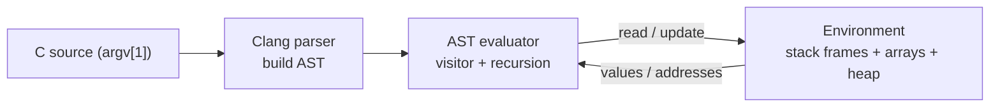
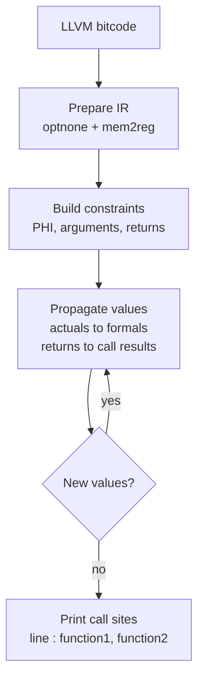
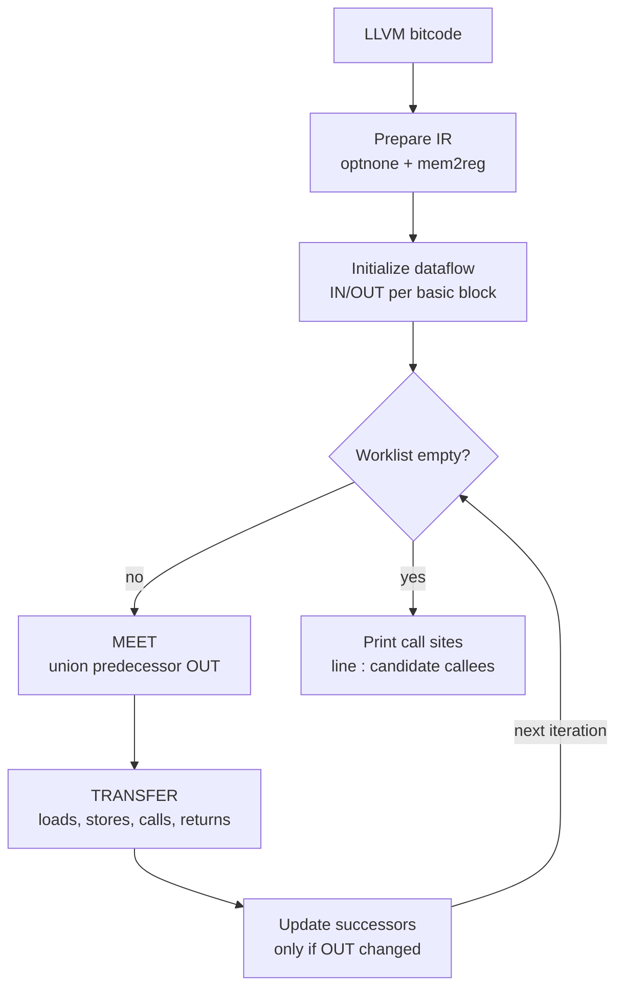

# Compiler Principles Labs

[English](README.md) | [简体中文](README.zh-CN.md)

This repository contains three compiler-course assignments based on Clang/LLVM. Each assignment is self-contained and has its own `CMakeLists.txt`.

## Prerequisites

- CMake
- LLVM and Clang development libraries (the code uses the legacy pass-manager APIs)
- Clang, for compiling C test cases to LLVM bitcode in Assignments 2 and 3

## Assignment 1: AST Interpreter

**Task:** Execute a restricted C program directly from its Clang AST.

The interpreter supports integer, character, and pointer values, arrays, arithmetic and comparison expressions, assignments, `if`, `while`, `for`, function calls and returns, and the built-in functions `MALLOC`, `FREE`, `GET`, and `PRINT`.

**Implementation:** The source text is parsed with `clang::tooling::runToolOnCode`. An `ASTConsumer` locates `main` and the built-in function declarations, while an `EvaluatedExprVisitor` walks expressions and statements. The interpreter keeps an explicit stack of frames. Each frame maps declarations and AST expressions to values, arrays, and addresses, and a separate simulated heap manages allocated memory. Statements are evaluated recursively; function calls create new frames, and pointer arithmetic is scaled by the pointee size.

**Algorithm overview:**



*The evaluator recursively walks the AST and reads or updates the runtime environment.*

## Assignment 2: Function-Pointer Analysis

**Task:** For an LLVM bitcode file generated from C, find the possible callee functions at every call site and print each result as:

```text
line : function1, function2
```

**Implementation:** The pass first removes the `optnone` attribute and runs `mem2reg` to promote local variables to SSA form. It then builds constraints of the form `value -> set of possible values` from PHI nodes and call/return flows. Actual arguments are propagated to formal parameters, and return values are propagated back to call results. The alias/value relations are expanded iteratively to a fixed point. Finally, each call site is resolved to a direct callee or to its candidate function set and printed using its source line.

**Algorithm overview:**



*Possible values are propagated across calls until no new candidates appear.*

The analysis is flow-insensitive and context-insensitive. Test cases and their expected outputs are in `assign2/assign2-tests`.

## Assignment 3: Dataflow-Based Points-to Analysis

**Task:** Implement a flow-sensitive, field- and context-insensitive points-to analysis, then print the possible callees of every call instruction in the same `line : function1, function2` format.

**Implementation:** `Dataflow.h` provides a generic worklist-based dataflow framework that computes per-basic-block `IN` and `OUT` values and supports both forward and backward analyses. `FuncPtr.h` defines the analysis state: a points-to map from LLVM values to sets of possible target values, a map of resolved call sites, and a set of possible return values. The transfer function handles memory loads and stores, address calculations, function calls, returns, and pointer casts. At the meet points, points-to sets are merged by set union. For an indirect call, the callee is analyzed recursively with actual-argument points-to information bound to its formal parameters; its return values and side effects are then merged back into the caller. This gives an interprocedural fixed-point analysis without context sensitivity.

**Algorithm overview:**



*Basic blocks are repeatedly processed until the points-to sets reach a fixed point; callees are analyzed recursively.*

`Liveness.h` is included as an example of a backward dataflow analysis. Test cases and their expected outputs are in `assign3/assign3-test`.

## Build

```bash
# Assignments 2 and 3
cmake -S assign2 -B build/assign2 -DLLVM_DIR="$(llvm-config --cmakedir)"
cmake --build build/assign2

cmake -S assign3 -B build/assign3 -DLLVM_DIR="$(llvm-config --cmakedir)"
cmake --build build/assign3

# Assignment 1 also needs ClangConfig.cmake
cmake -S assign1 -B build/assign1 \
  -DLLVM_DIR="$(llvm-config --cmakedir)" \
  -DClang_DIR="$(dirname "$(llvm-config --cmakedir)")/clang"
cmake --build build/assign1
```

## Run

Assignment 1 takes the C source text as a single command-line argument:

```bash
./build/assign1/ast-interpreter \
  'int PRINT(int); int main() { int i = 0; while (i < 3) i = i + 1; PRINT(i); return 0; }'
```

Assignments 2 and 3 take LLVM bitcode. For example:

```bash
clang -O0 -g -emit-llvm -c assign2/assign2-tests/test00.c -o test00.bc
./build/assign2/llvmassignment test00.bc

clang -O0 -g -emit-llvm -c assign3/assign3-test/test00.c -o test00.bc
./build/assign3/assignment3 test00.bc
```
